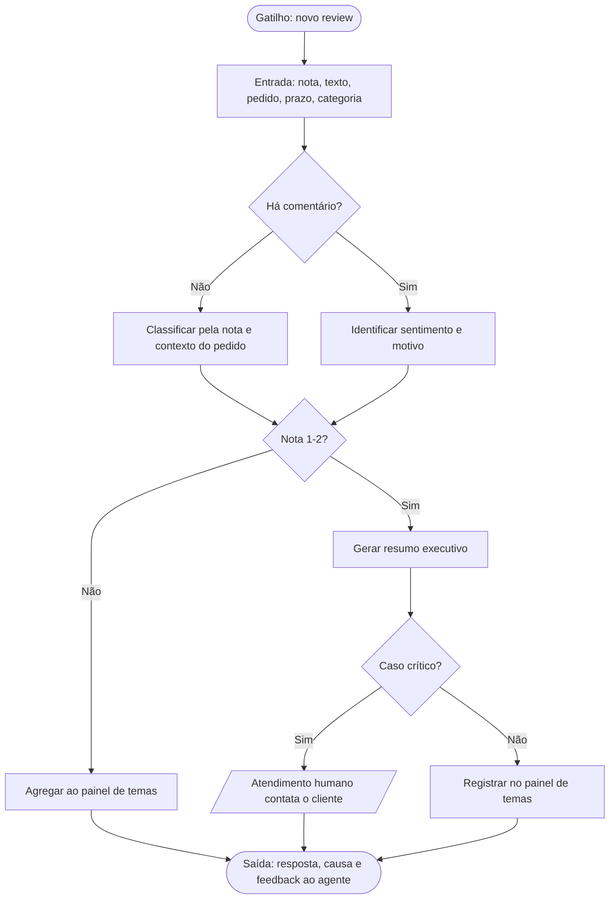
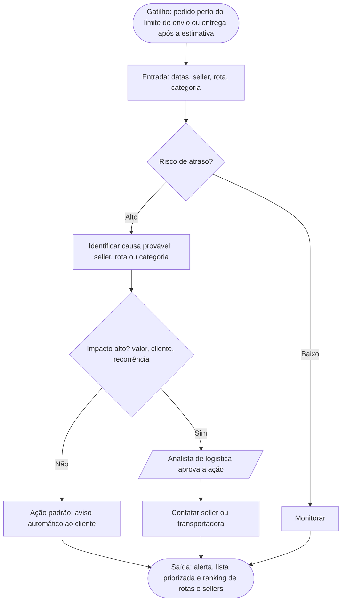
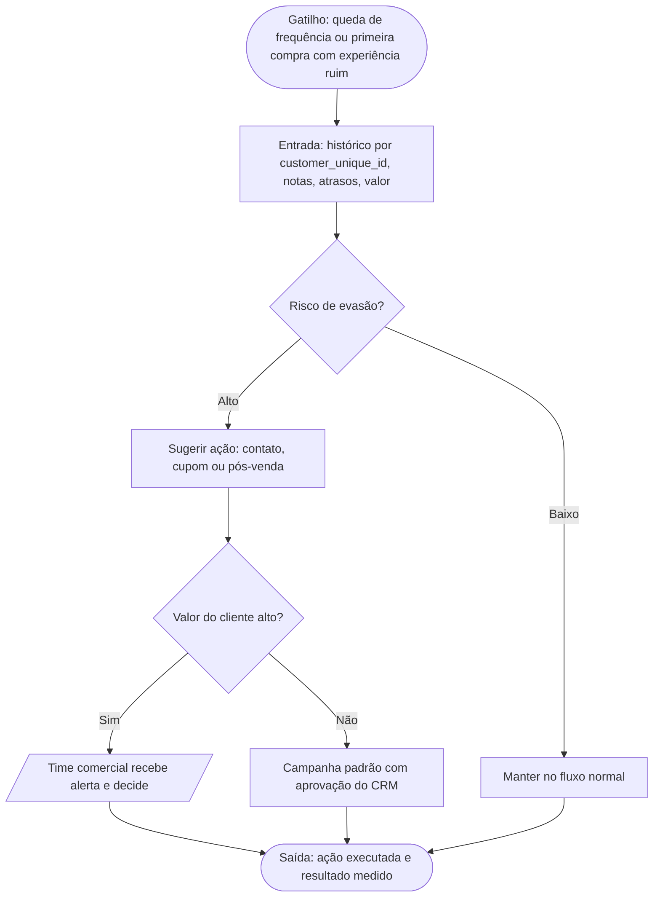
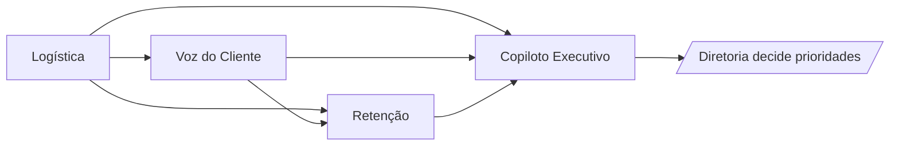

# Relatório Executivo — Fase 2

> Evolução do relatório da Fase 1. A Parte A resume o que mudou; a Parte B detalha agentes, jornadas, prompts e vídeo; a Parte C preserva integralmente o relatório da Fase 1 como base.

**Vídeo executivo (4 min 57 s):** [Assistir ao vídeo](https://github.com/user-attachments/assets/983ade2d-b182-42a8-a866-b247fa873a29) — roteiro em `docs/roteiro_video_executivo.md`.

## Parte A — Evolução em relação à Fase 1

| Tema | Fase 1 | Fase 2 |
|---|---|---|
| Foco | Diagnóstico e visão estratégica | Detalhamento operacional de 3 agentes prioritários |
| Agentes | Mapa conceitual com 4 agentes | Objetivo, problema, usuários, dados, entradas/saídas e KPIs por agente |
| Operação | Arquitetura conceitual | Jornadas com gatilho, decisão, ação, interação humana e saída |
| Prompts | Diretrizes gerais | Prompts estruturados (objetivo, contexto, instrução, resultado esperado) |
| Evidência | Baseline agregado | Cruzamento de dados que justifica o investimento |

### 1. Evidências novas extraídas do dataset

Cruzando pedidos entregues com reviews (um review por pedido; 95.824 pedidos):

| Grupo | Pedidos | Nota média | % notas 1–2 |
|---|---|---|---|
| Entregues no prazo | 88.163 | 4,29 | 9,2% |
| Entregues com atraso | 7.661 | 2,57 | 54,1% |

**Leitura executiva:** atraso é o principal gatilho mensurável de insatisfação; pedidos atrasados têm cerca de 6x mais chance de nota 1–2. Isso sustenta priorizar os agentes de Logística e de Voz do Cliente na Onda 1.

**Achado de cautela (retenção):** a recompra observada é de ~3,1% tanto para clientes cuja primeira compra teve nota 1–2 (14.035) quanto para os demais (81.345). O histórico não mostra diferença; por isso o agente de churn atua como **gerador de hipóteses** até haver CRM, engajamento e janela de observação. Esse ajuste de expectativa faz parte da evolução do projeto.

### 2. Agentes selecionados

Dos quatro agentes da Fase 1, detalhamos três que cobrem as dores centrais: **Voz do Cliente**, **Exceções Logísticas** e **Retenção e Churn**. O Copiloto Executivo consolida as saídas e permanece na Onda 3.

## Parte B — Detalhamento da Fase 2

### 3. Casos de uso detalhados

#### 3.1 Agente de Voz do Cliente (Reviews)

| Item | Detalhe |
|---|---|
| **a) Objetivo** | Automatizar a leitura de reviews, classificar sentimento e motivo da reclamação e apoiar a priorização de ações. |
| **b) Problema resolvido** | *Dor:* 14,7% dos reviews têm nota 1–2 e só 41,3% trazem texto; a leitura manual é lenta e não gera causa-raiz. *Impacto atual:* temas críticos são percebidos tarde. *Consequência:* dano à reputação, queda de NPS e repetição das falhas. |
| **c) Usuários** | Analista de CX, atendimento, gestor de produto, seller (via CX), diretoria. |
| **d) Dados** | `order_reviews` (nota, título, comentário, datas), `orders` (prazos), `order_items`, `products` e `product_category_name_translation` (categoria), `sellers`. Externos: tickets, NPS, redes sociais e marketplaces (futuro). |
| **e) Entradas / Saídas** | *Entradas:* review novo (especialmente nota ≤ 2), dados do pedido, prazo, categoria. *Saídas:* classificação (atraso, qualidade, produto errado, embalagem, atendimento), resumo executivo, alerta de caso crítico, painel semanal de temas. |
| **f) Indicadores** | % de reviews 1–2, nota média por categoria/seller, tempo de resposta a reviews críticos, NPS/CSAT (quando disponível), horas de leitura manual. |

#### 3.2 Agente de Exceções Logísticas

| Item | Detalhe |
|---|---|
| **a) Objetivo** | Reduzir atrasos priorizando exceções por impacto e identificando causa-raiz por região, vendedor e categoria. |
| **b) Problema resolvido** | *Dor:* 8,1% das entregas (7.826) chegaram após a data estimada. *Impacto atual:* pedidos atrasados têm 54,1% de reviews 1–2 contra 9,2% no prazo. *Consequência:* insatisfação, retrabalho de atendimento e perda de confiança. |
| **c) Usuários** | Operações/logística, gestor de SLA, atendimento, gestão de sellers. |
| **d) Dados** | `orders` (compra, aprovação, envio, entrega e estimativa), `order_items` (seller, frete, limite de envio), `sellers`, `customers` e `geolocation` (UF/região), `products`. Externos: tracking de transportadoras, clima, feriados e greves. |
| **e) Entradas / Saídas** | *Entradas:* pedido em risco (envio perto do limite, rota historicamente lenta) ou já atrasado. *Saídas:* lista priorizada de exceções, causa provável, ação sugerida (contatar seller, avisar cliente), alerta ao responsável, ranking de sellers/rotas críticos. |
| **f) Indicadores** | Taxa de atraso, SLA de entrega, prazo médio (12,6 dias), tempo de resolução de exceções, contatos de suporte por atraso, nota média de pedidos atrasados. |

#### 3.3 Agente de Retenção e Churn

| Item | Detalhe |
|---|---|
| **a) Objetivo** | Identificar segmentos com baixa recompra e experiência negativa e sugerir ações de retenção. |
| **b) Problema resolvido** | *Dor:* apenas 3,1% dos clientes únicos recompraram. *Impacto atual:* custo de aquisição sem retorno recorrente. *Consequência:* LTV baixo e orçamento de retenção mal direcionado. |
| **c) Usuários** | CRM, comercial, sucesso do cliente, liderança de receita. |
| **d) Dados** | `customers` (`customer_unique_id`), `orders`, `order_payments` (valor, parcelas, meio), `order_reviews`, `order_items`, `geolocation`. Externos: CRM, engajamento, campanhas, tickets. |
| **e) Entradas / Saídas** | *Entradas:* segmento com baixa recompra, primeira compra com atraso ou nota baixa, valor do pedido. *Saídas:* segmentos em risco com fatores, ação recomendada (cupom, contato proativo, pós-venda), alerta ao time comercial, potencial de recuperação. |
| **f) Indicadores** | Taxa de recompra por `customer_unique_id`, churn por segmento (com CRM), LTV, retorno de campanhas, retenção pós-atraso. |

### 4. Jornadas de funcionamento dos agentes

Fluxos em Mermaid (renderizam no GitHub; importáveis no Draw.io via Arrange > Insert > Advanced > Mermaid). Losangos são decisões; paralelogramos são interações humanas.

#### 4.1 Agente de Voz do Cliente

*Caso crítico (regra inicial, a validar com CX):* nota 1, pedido atrasado, produto não recebido ou cliente de alto valor.

#### 4.2 Agente de Exceções Logísticas

#### 4.3 Agente de Retenção e Churn

#### 4.4 Visão integrada

### 5. Estruturação inicial de prompts

Podem ser testados em ChatGPT, Claude, Gemini, Copilot ou Notion AI, colando amostras de dados no contexto. Regras comuns: separar fato, hipótese e recomendação; declarar dados ausentes; não inferir satisfação de reviews sem texto.

#### 5.1 Resumir avaliações negativas (Voz do Cliente)

- **a) Objetivo:** resumir avaliações negativas e classificar o motivo.
- **b) Contexto fornecido:** nota, título e comentário do review; datas estimada e realizada de entrega; categoria do produto; seller; valor do pedido.
- **c) Instrução principal:**
  > Você é analista de CX. Com base no review e nos dados do pedido abaixo, gere um resumo executivo do problema em até 3 linhas e classifique o motivo em uma categoria: atraso, produto com defeito, produto diferente, não recebido, embalagem, atendimento ou outro. Se não houver texto, use apenas nota e prazo e informe a limitação. Indique se o caso é crítico (nota 1 com atraso, produto não recebido ou valor alto) e por quê. Não invente fatos.
  > [DADOS DO PEDIDO]
- **d) Resultado esperado:** resumo executivo; classificação; criticidade com justificativa; recomendação; alerta ao atendimento humano quando crítico.

#### 5.2 Priorizar exceções de entrega (Logística)

- **a) Objetivo:** priorizar pedidos atrasados ou em risco.
- **b) Contexto fornecido:** pedidos com datas de compra, envio, entrega e estimativa; seller; UF de origem e destino; categoria; frete; nota do review, se houver.
- **c) Instrução principal:**
  > Você apoia a operação logística. Para cada pedido, calcule os dias de atraso, agrupe por seller, rota e categoria e ordene por impacto (atraso, valor, reincidência e nota do review). Para as 5 principais exceções, indique causa provável, ação sugerida e área responsável. Informe que não há dados de tracking e marque o que exige validação humana.
- **d) Resultado esperado:** tabela priorizada; causa provável; ação recomendada; alerta ao responsável; limitações.

#### 5.3 Identificar risco de evasão (Retenção)

- **a) Objetivo:** apontar segmentos em risco e sugerir ações de retenção.
- **b) Contexto fornecido:** por `customer_unique_id`: nº de pedidos, datas, valor, meio de pagamento, notas, atrasos, UF.
- **c) Instrução principal:**
  > Você apoia CRM e comercial. Analise o histórico por `customer_unique_id` e identifique segmentos com maior risco de não recompra, citando os fatores observados. Para cada segmento, proponha uma ação de retenção e a prioridade. Não classifique churn individual sem janela de observação e dados de CRM; trate os resultados como hipóteses e informe as incertezas.
- **d) Resultado esperado:** segmentos em risco; fatores; criticidade; ação recomendada; alerta ao time comercial; incertezas.

#### 5.4 Resumo executivo consolidado (Copiloto)

- **a) Objetivo:** sintetizar as saídas dos agentes para a diretoria.
- **b) Contexto fornecido:** saídas dos três agentes, KPIs e metas.
- **c) Instrução principal:**
  > Consolide as análises abaixo em um resumo executivo de uma página: 3 prioridades, impacto esperado, riscos, dependências e decisões que exigem aprovação humana.
- **d) Resultado esperado:** resumo; prioridades; recomendação; itens para decisão.

### 6. Vídeo executivo

Apresentação de até 5 minutos para os executivos que aprovarão o investimento (roteiro em `docs/roteiro_video_executivo.md`):

1. Evolução da Fase 1 para a Fase 2 (30 s);
2. Evidência: atraso x nota 1–2 (45 s);
3. Detalhamento dos 3 agentes (90 s);
4. Fluxos construídos (60 s);
5. Exemplo de interação com um prompt (45 s);
6. Pedido de decisão: aprovar o piloto da Onda 1 (30 s).

**Link:** [Assistir ao vídeo](https://github.com/user-attachments/assets/983ade2d-b182-42a8-a866-b247fa873a29)

### 7. Plano de piloto e critérios de sucesso

- **Onda 1:** Voz do Cliente e Exceções Logísticas com os dados disponíveis; **Onda 2:** Retenção após integrar CRM; **Onda 3:** Copiloto.
- **Metas a validar no piloto:** reduzir o tempo de triagem de reviews críticos, aumentar a resolução de atrasos antes do review e reduzir a leitura manual. Metas numéricas dependem da linha de base operacional.
- **Governança:** humano aprova ações críticas; trilha de auditoria; dono de negócio por agente.

## Parte C — Relatório da Fase 1 (base preservada)

### Relatório Executivo — Fase 1

#### 1. Objetivo da Fase 1

Estruturar uma visão executiva para adoção de agentes de IA orientados a resultado de negócio, com foco em melhorar experiência do cliente, eficiência operacional, qualidade logística e capacidade de resposta sobre sinais vindos de reviews e retenção.

Esta fase prioriza análise estratégica, definição de oportunidades, desenho conceitual da solução e alinhamento com diretoria antes de qualquer implantação técnica.

#### 2. Contexto de Negócio

O problema proposto indica um ambiente com pressão simultânea sobre:

- satisfação e experiência do cliente;
- desempenho logístico;
- volume de feedback em reviews;
- retenção de clientes;
- eficiência operacional.

Esse cenário normalmente aponta para empresas que já possuem dados relevantes, porém ainda não transformam esses dados em decisões rápidas, priorização confiável e ações coordenadas entre áreas.

#### 3. Baseline Observado no Dataset Olist

O recorte disponível cobre compras entre setembro de 2016 e outubro de 2018 e permite validar parte relevante das hipóteses da Fase 1:

- 99.441 pedidos de 96.096 clientes únicos; 96.478 pedidos foram entregues (97,0%);
- 7.826 pedidos entregues chegaram após a data estimada (8,1% das entregas), com prazo médio de entrega de 12,6 dias;
- 14,7% dos reviews receberam nota 1 ou 2, enquanto 57,8% receberam nota 5;
- somente 41,3% dos reviews contêm comentário textual, o que limita a cobertura da análise semântica;
- 3,1% dos clientes únicos têm mais de um pedido observado, logo recompra é um proxy histórico e não uma medida de churn em tempo real.

O dataset não contém tracking de transportadoras, tickets, NPS, campanhas ou CRM. As conclusões devem, portanto, diferenciar o diagnóstico histórico suportado pela base de automações operacionais que dependerão de novas integrações.

#### 4. Problema Central

O negócio provavelmente enfrenta uma combinação de cinco dores:

1. dificuldade de identificar rapidamente os fatores que mais impactam clientes;
2. baixa visibilidade sobre gargalos operacionais e logísticos;
3. uso reativo de reviews e reclamações, sem geração sistemática de causa-raiz;
4. dificuldade de antecipar risco de churn ou queda de recompra;
5. excesso de esforço manual para consolidar dados e apoiar decisões.

Em termos executivos, o problema não é apenas “falta de IA”, mas sim falta de uma camada inteligente de priorização, diagnóstico e apoio à ação.

#### 5. Hipóteses de Oportunidade

Com o dataset do Brazilian Ecommerce disponível como base analítica do projeto, é possível formular hipóteses de alto valor a partir dos dados reais de clientes, pedidos, logística e reviews:

- clientes insatisfeitos podem estar concentrados em jornadas específicas;
- atrasos logísticos podem estar associados a regiões, transportadoras, categorias ou períodos;
- reviews podem conter sinais recorrentes que não aparecem em indicadores agregados;
- queda de retenção pode decorrer de experiências ruins logo nas primeiras interações;
- equipes operacionais e gerenciais podem gastar tempo excessivo consolidando informação antes de agir.

#### 6. Análise Estratégica por Frente

##### 6.1 Clientes

Questões-chave:

- quais perfis concentram maior valor e maior risco;
- quais jornadas geram maior fricção;
- quais segmentos apresentam maior reclamação, atraso ou cancelamento;
- quais grupos respondem melhor a ações corretivas.

Valor esperado:

- melhor priorização comercial e de atendimento;
- redução de perdas em contas relevantes;
- foco em segmentos com maior retorno.

##### 6.2 Logística

Questões-chave:

- onde estão os principais atrasos;
- quais rotas, parceiros ou categorias mais falham;
- qual o impacto operacional e reputacional dessas falhas;
- quais desvios podem ser tratados de forma preditiva.

Valor esperado:

- redução de exceções;
- melhoria do SLA;
- menor custo de retrabalho e atendimento;
- ganho de previsibilidade operacional.

##### 6.3 Reviews e Voz do Cliente

Questões-chave:

- quais temas aparecem com maior recorrência;
- quais problemas são mais críticos para percepção de valor;
- quais temas estão crescendo;
- quais problemas podem ser resolvidos com ação rápida entre áreas.

Valor esperado:

- leitura contínua de voz do cliente;
- redução do tempo entre problema percebido e resposta da empresa;
- melhoria de reputação e NPS.

##### 6.4 Retenção

Questões-chave:

- quais sinais antecedem churn, queda de recompra ou abandono;
- quais jornadas geram erosão de confiança;
- quais intervenções têm maior probabilidade de retenção.

Valor esperado:

- priorização de ações de recuperação;
- melhor uso de orçamento de retenção;
- aumento de lifetime value.

##### 6.5 Eficiência Operacional

Questões-chave:

- quanto esforço humano hoje é gasto para consolidar análises;
- quantas decisões ficam lentas por falta de diagnóstico;
- quais equipes dependem de relatórios manuais;
- quais processos podem ser apoiados por agentes especializados.

Valor esperado:

- redução de tempo analítico;
- aumento da velocidade de resposta;
- padronização de análises;
- maior capacidade de escala.

#### 7. Benefícios Esperados

##### Benefícios para o negócio

- melhor qualidade de decisão;
- priorização orientada a impacto;
- maior capacidade de resposta interáreas;
- redução de perdas por churn, atraso e experiência ruim.

##### Benefícios para operação

- triagem automática de sinais;
- menor dependência de consolidação manual;
- alertas mais rápidos;
- padronização de diagnóstico.

##### Benefícios para liderança

- visão executiva unificada;
- clareza sobre onde atuar primeiro;
- rastreabilidade de hipóteses, riscos e ganhos;
- base para investimento em Fase 2.

#### 8. Usuários Impactados

##### Diretoria e liderança

- usam a solução para priorização, governança e alocação de recursos.

##### Operações e logística

- usam diagnósticos e alertas para atacar causas de atraso, erro ou exceção.

##### CX, atendimento e sucesso do cliente

- usam leitura de reviews e sinais de insatisfação para resposta coordenada.

##### Comercial, CRM e retenção

- usam insights para campanhas de retenção, reativação e foco em clientes de maior valor.

##### Analytics e produto de dados

- usam a arquitetura proposta para evoluir métricas, monitoramento e automações futuras.

#### 9. Riscos e Limitações

##### Riscos de negócio

- priorizar casos de uso sem impacto mensurável;
- gerar confiança excessiva em recomendações ainda não validadas;
- baixa adesão se a solução não se integrar ao fluxo real das áreas.

##### Riscos de dados

- ausência de padronização entre fontes;
- reviews sem qualidade suficiente para análise semântica robusta;
- histórico incompleto para retenção;
- granularidade insuficiente em eventos logísticos.
- ausência de fontes operacionais necessárias para alertas em tempo real;
- duplicidade potencial de `review_id` e `order_id` nos reviews;
- necessidade de usar `customer_unique_id`, e não `customer_id`, em análises de recompra.

##### Riscos operacionais

- excesso de agentes sem clareza de dono e processo;
- falta de SLA para resposta humana;
- baixa governança de exceções.

##### Riscos éticos e de governança

- enviesamento em priorização de clientes;
- decisões automatizadas sem supervisão adequada;
- uso inadequado de dados sensíveis;
- falta de trilha de auditoria.

#### 10. Recomendações Executivas

1. começar por casos de uso com impacto claro e disponibilidade de dados;
2. definir indicadores de sucesso antes da implementação;
3. usar agentes como apoio à decisão, não substituição integral da governança humana;
4. garantir dono de negócio para cada agente;
5. evoluir por ondas: diagnóstico, piloto controlado e expansão.

#### 11. Critérios de Priorização para a Fase 2

Os casos de uso devem ser priorizados segundo:

- impacto econômico potencial;
- urgência operacional;
- disponibilidade e qualidade de dados;
- simplicidade de integração ao processo atual;
- capacidade de medir resultado rapidamente.

#### 12. Indicadores Executivos Recomendados

- taxa de atraso logístico;
- tempo médio de resolução de exceções;
- volume e severidade de reviews negativos;
- taxa de pedidos entregues após a data estimada;
- taxa de reviews com nota 1 ou 2;
- taxa de recompra por `customer_unique_id`;
- churn por segmento, quando houver base CRM longitudinal;
- tempo gasto em consolidação analítica;
- taxa de adoção das recomendações dos agentes.

#### 13. Próximos Passos Imediatos

1. formalizar as métricas e chaves descritas no inventário de dados;
2. priorizar o diagnóstico de atraso e reviews negativos, já mensuráveis na base;
3. validar com as áreas as dores prioritárias e as ações possíveis;
4. selecionar um piloto de maior valor;
5. integrar tracking, atendimento e CRM antes de propor alertas operacionais ou retenção em tempo real.

#### 14. Conclusão

A oportunidade da Fase 1 é criar base decisória para usar IA com foco real em negócio. O maior ganho esperado não é apenas automação, mas capacidade de transformar dados dispersos em priorização prática, resposta mais rápida e melhoria contínua da experiência do cliente e da operação.

Com o dataset completo disponível, este relatório passa a ter um baseline quantitativo para orientar o piloto. A validação do contexto operacional atual e a integração de fontes ausentes continuam necessárias antes de escalar recomendações para execução.
